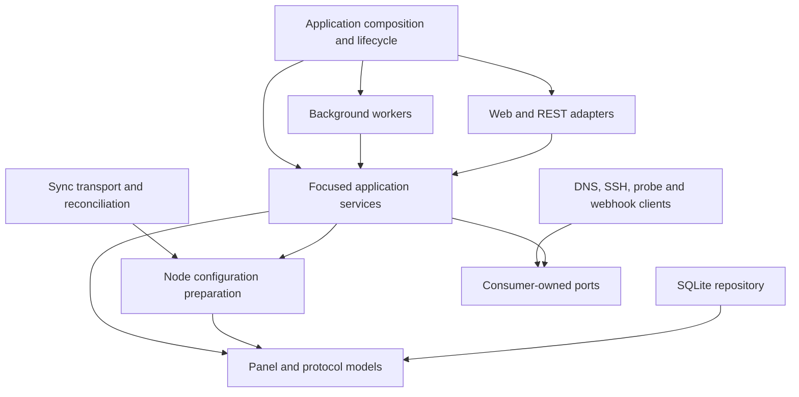

# Architecture boundaries

The panel remains a modular application; the agent remains a separate executable.
HTTP, gRPC and database schemas are unchanged by the architecture refactor.

`internal/model` owns panel entities, protocol parameters, Sync messages and access
policy. `internal/service` owns business operations and declares repository and
external capability interfaces. Services never import concrete repositories,
clients, platform adapters, workers, transports or the application.

`internal/app/panelapp` stores dependencies directly in private application fields.
Methods construct and cache repositories, clients, services, servers and workers.
Construction is split into `application.go`, `database.go`, `repositories.go`,
`client.go`, `service.go`, `server.go` and `worker.go`; there is no administrator
facade, assembly package or separate component container. Server dependencies are
prepared before concurrent work starts. CLI commands and integration fixtures use
the same application construction methods, preserving explicit dependency overrides.

REST and web declare separate interfaces for users, tokens, node writes, node
queries, hosts, provisioning and network operations. They receive only those
capabilities, never the whole app or a concrete SQLite store.

`internal/worker` owns execution and scheduling:

| Package | Responsibility |
| --- | --- |
| `watchsched` | Periodic user expiry, limit and notification checks |
| `healthsched` | Periodic node availability checks |
| `events` | In-memory webhook queue and delivery retries |
| `reconciliation` | Reconciliation scheduling by timer and `Kick` |
| `tasks` | Application-owned background provisioning and network tasks |
| `enginequeue` | Per-engine apply queues and state/statistics collection |
| `netqueue` | Serialized agent network command application |

Workers consume narrow operation interfaces. Business decisions, state changes and
single-pass operations remain in services; services accept an executor port for
asynchronous jobs. Application code assembles, starts, cancels and joins workers.
Sync stream receive/send loops remain transport/session code.

One credential coordinator connects users, nodes, provisioning and health checks.
Credential allocation also serializes with Sync configuration preparation. A shared
state mutex coordinates node mutation, health results and network installation changes.
`service/nodestate` admits agents, records reported state and traffic and prepares
desired configs; the hub handles stream delivery, per-stream resend protection and
throttling, and delegates the reconciliation pass to `nodestate`. The reconciliation
worker owns the periodic loop and `Kick` subscription lifetime.
Web exports WireGuard documents through node queries.

`internal/repository/sqlite` opens the database and applies `migrations`; each domain
repository beneath it (`users`, `nodes`, `network`, ...) owns its SQL, one query per file.
`internal/repository/pkifs`
owns PEM persistence and TLS loading. Certificate issuance lives in `service/pki`,
and verified stream identities in `transport/grpc/nodeauth`. Installer resources,
archives and cloud-init live in `platform/installation`; SSH executes through
`clients/ssh`. Webhook delivery uses `clients/webhook` behind the event worker port.

`App.Run` and `App.Close` share cancellation. Startup and closure are serialized;
closure cancels requests and work, stops gRPC and HTTP, waits for active handlers
and tracked workers (including nested probes, provisioning and network operations),
then closes SQLite. Constructor and partial startup failures use the same
idempotent cleanup path. A rejected
second `Run` does not close a running instance.

## Creation and recovery

Node creation commits the node and all its inbounds in one transaction. Generated IDs
are published to callers only after commit. Both statement and commit failures roll
back the aggregate. No schema migration is needed.

Peer issuance and monitor preparation happen after creation commits. Errors are logged;
config reconciliation retries peer issuance and health checks retry monitor preparation.
Existing monitor credentials are reused without another config notification. These
preparation steps do not form a distributed transaction with external services.

## User access policy

`model/panel.User.Status` defines disabled, expired, limited and active states, in that order.
Admin views and subscription status use this policy. SQL retains efficient filtering
of active users; traffic offsets clamp upload and download independently, matching the
usage reported to clients after resets and removal of historical nodes.

A disabled user receives HTTP 403 for a subscription. Expired and limited users still
receive their subscription and actual usage headers, while remaining absent from node
configs. Presentation strings and public contracts are preserved.

## Verification

`go test ./...` includes import-boundary checks, SQL rollback and traffic regressions,
and the existing HTTP/gRPC and agent dependency tests. Integration scenarios use
the actual application wiring, while worker tests cover execution/cancellation and
application tests cover dependency lifetime and shutdown ordering. `go test -race ./...` checks the
shared allocation and token-authentication state. External sing-box/Mihomo validators
and the Docker network bench remain separate checks described in the README.
